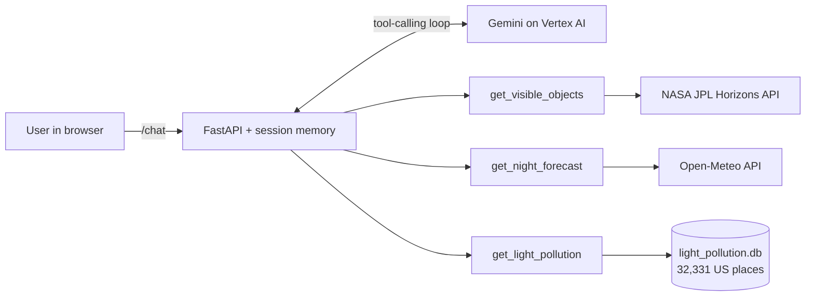

# 🔭 First Light

**An AI stargazing guide for people who just got their first telescope.**

Tell it your city. It checks NASA's planet positions, tonight's cloud forecast, and a light pollution
database of 32,000+ US places, then tells you what to point at, which way to face, how high to
look, and whether you'll need a telescope at all.


<!-- Add a screenshot or GIF of a conversation here, e.g.  -->

> *"First light" is what astronomers call the first time a new telescope is pointed at the sky.*

---

## The problem

A new telescope owner walks outside, looks up, and has no idea where to point it. Star charts assume
you already know the sky. Weather apps don't say whether the sky will be clear *at 11pm*. And
nobody tells you that from downtown Chicago, the faint galaxies on the telescope box are never
going to show up.

First Light answers the questions beginners actually ask:

- *Is Saturn up tonight? Which way do I face?*
- *Which night this week is clear enough to go out?*
- *Why can't I see any stars from my apartment, and where should I drive instead?*

## Example

> **You:** I live in Chicago and I can barely see any stars. Is my city too light polluted? Where should I go?
>
> **First Light:** Chicago scores a **10 out of 10** on the light pollution scale. The city glow is over
> 46 times brighter than a natural night sky, which is why you can barely see anything overhead.
> The good news is that the **Moon and planets still look fantastic** right from the city. For the
> Milky Way, the nearest dark sky is about **80 miles southeast near Pulaski, Indiana**, which
> scores a 4.

Every answer is grounded in tool calls, and the UI shows each one: what was asked, and the raw
data that came back.

## How it works



Gemini decides which tools to call. A small harness runs them, feeds the results back, and loops
until the model answers. Each browser session keeps its own conversation, so follow-ups like
*"what about Nashville?"* just work.

### The tools

| Tool | What it answers | Data |
| --- | --- | --- |
| `get_visible_objects` | Which planets, the Moon, asteroids or comets are above the horizon after dark; the best time; the compass direction; how high; and whether you need eyes, binoculars or a telescope | [NASA JPL Horizons](https://ssd-api.jpl.nasa.gov/doc/horizons.html) |
| `get_night_forecast` | Hour-by-hour cloud cover, rain chance, temperature and wind between sunset and sunrise for up to 14 nights, rated great / okay / poor | [Open-Meteo](https://open-meteo.com/) |
| `get_light_pollution` | A US city's light pollution score (1–10), what you can still see there, and the nearest town with a dark sky, with miles and direction | Custom SQLite database (below) |

## The light pollution database

The most interesting part of the project. There's no free API that answers "how bright is the sky
in my town?", so I built the dataset myself in [`build_db.py`](build_db.py):

1. **Every US place.** All 32,331 cities, towns and census-designated places from the
   [US Census 2024 Gazetteer](https://www.census.gov/geographies/reference-files/time-series/geo/gazetteer-files.html),
   including Puerto Rico.
2. **Satellite-derived sky brightness.** Each place is located on the 15,480 × 8,160-pixel North
   America map of the [2025 World Atlas of Artificial Night Sky Brightness](https://djlorenz.github.io/astronomy/lp/)
   by David Lorenz, which is modeled from NOAA's VIIRS night-light satellite data.
3. **Pixel → score.** The map's color at that spot is one of 15 light pollution zones, which the
   script converts into a 1–10 score plus the ratio of city glow to natural sky brightness.

The tool then finds the **nearest dark sky** (score ≤ 4) with a bounding-box query and great-circle
distance. From New York City, for example, that's Shokan, NY, in the Catskills, 88 miles north.

## Engineering notes

A few real problems I hit and how I solved them:

- **NASA rate-limits parallel requests.** Horizons returns HTTP 503 when more than about two
  requests arrive at once. The tool caps concurrency at 2 and retries once after a short pause, so
  checking 8 objects takes about 4 seconds.
- **Census coordinates can be miles from downtown.** Anchorage spans 1,700 square miles, and its
  Census point lands in the Chugach Mountains, which made it look like a dark-sky site. Big cities
  now use downtown coordinates from a top-1,000 cities list.
- **Names are ambiguous.** There are dozens of Springfields, and the Census calls Nashville
  "Nashville-Davidson". Lookups match name variants, prefer the larger city, and when that's still
  ambiguous, return an error telling the model to ask the user which state.
- **Errors are written for the model.** Every tool returns a clear message (an unknown city, a busy
  server, an invalid date) instead of raising, so Gemini can recover or ask a follow-up.
- **Weekday hallucination.** Gemini once called Tuesday "Monday" when it only had ISO dates. The
  tools now return the weekday name explicitly.
- **Honest data labeling.** The atlas author asks that his maps not be presented as the Bortle
  scale, since they measure brightness straight overhead. The 1–10 score is a separate scale, and
  it's labeled that way.

## Tech stack

**Python** · **FastAPI** · **LiteLLM** · **Gemini (Vertex AI)** · **SQLite** · **Pillow** (dataset
build) · vanilla **HTML/JS** with marked + DOMPurify · deployed on **Google Cloud Run** with continuous
deployment from GitHub

## Try it

1. **What can I see tonight from New York with a small telescope?**
2. **Which night this week is best to see Saturn from Chicago?**
3. **I live in Los Angeles and can barely see any stars. Is my city too light polluted, and where should I go?**

## Run it locally

You need [uv](https://docs.astral.sh/uv/) and a Google Cloud project with the Vertex AI API enabled.

```bash
gcloud auth application-default login
```

```bash
uv run app.py
```

Then open http://localhost:8000. NASA Horizons and Open-Meteo need no API keys.

To rebuild the light pollution database from the source data:

```bash
uv run --with pillow build_db.py
```

## Project structure

```
app.py              FastAPI server, session store, and the tool-calling loop
tools.py            The three tools and the descriptions Gemini sees
index.html          Chat UI
build_db.py         Builds light_pollution.db from Census + atlas data
light_pollution.db  32,331 US places with light pollution scores
```

## Credits

- Light pollution data: [World Atlas of Artificial Night Sky Brightness, 2025](https://djlorenz.github.io/astronomy/lp/), David Lorenz, based on VIIRS data from the Earth Observation Group, Colorado School of Mines
- Places: [US Census Bureau Gazetteer Files](https://www.census.gov/geographies/reference-files/time-series/geo/gazetteer-files.html)
- City populations: [plotly/datasets](https://github.com/plotly/datasets)
- Planet positions: [NASA JPL Horizons](https://ssd.jpl.nasa.gov/horizons/)
- Weather and geocoding: [Open-Meteo](https://open-meteo.com/)

Built as a class project at Columbia University.

## License

The code is released under the [MIT License](LICENSE). The data sources above keep their own terms.
